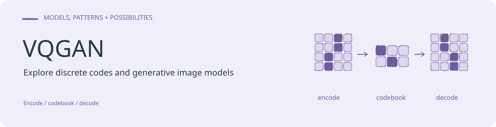
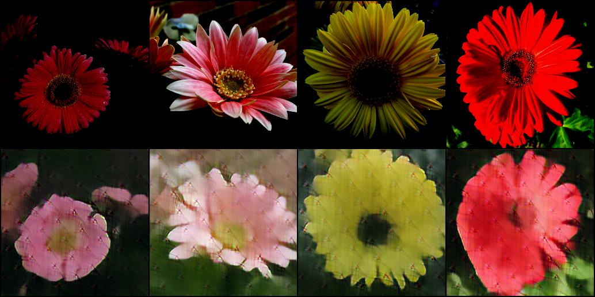

<!-- readme-visual-refresh:banner -->

<!-- /readme-visual-refresh:banner -->

An implementation of "Taming Transformers for High-Resolution Image Synthesis" 

<!-- readme-visual-refresh:artwork-source -->
[Editable banner artwork · Excalidraw](assets/readme/banner.excalidraw)
<!-- /readme-visual-refresh:artwork-source -->

<!-- readme-visual-refresh:additional-result -->
## Project output preview

项目所附上游 VQGAN 教程 README 的历史 Stage 1、epoch 50 重建示例。作者 Dominic Rampas；本次仅复用原链接图片，不是 GISWLH 分支本轮训练或推理结果。

[Original source](https://user-images.githubusercontent.com/61938694/154057511-266fa6ce-5c45-4660-b669-1dca0841823f.jpg). Copyright (c) 2022 Dominic Rampas. Bundled MIT license copied as UPSTREAM-LICENSE.txt.
<!-- /readme-visual-refresh:additional-result -->
